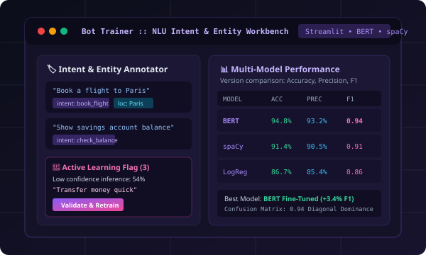

# 🚀 Sona Rose Devasia - Computer Science Portfolio

A high-performance, developer-first personal portfolio website crafted for **Sona Rose Devasia**, B.Tech Computer Science student at Amal Jyothi College of Engineering. Designed with clean modern aesthetics, deep engineering substance, and interactive innovations.



---

## ✨ Highlights & Features

- **Developer & AI Aesthetic**: Sleek obsidian dark palette with electric indigo and cyan accents, clean monospace accents, glassmorphic card overlays, and subtle glowing borders.
- **Interactive Neural Particle Canvas**: Smooth, high-performance HTML5 canvas background simulating neural connections and cursor magnetism (battery-friendly, auto-pauses when inactive or on reduced motion).
- **Interactive Developer CLI Terminal (`sona-cli`)**:
  - Floating access button (`>_ sona-cli`)
  - Run commands like `help`, `whoami`, `skills`, `projects`, `education`, `experience`, `certs`, `stats`, `neofetch`, `matrix`, `sudo hire`, `theme <name>`, and `clear`.
- **Command Palette (`Ctrl+K` / `⌘K`)**: Spotlight-style quick keyboard navigation across all sections, projects, themes, and instant actions.
- **Hero Mini-IDE Code Runner**: Live Python & ML developer card with interactive `▶ Run Script` button and execution console.
- **Flagship Project Deep-Dives**: Interactive modal with system architecture breakdowns, metrics, challenges solved, and direct GitHub links.
- **Dynamic Skills Arsenal**: Real-time search and category filtering across Programming Languages, Web & Frameworks, Machine Learning & AI, Database & Tools, and Concepts & Soft Skills.
- **Education & Experience Timelines**: Dual-column layout displaying internship achievements at NeST Digital & Infosys Springboard, CGPA (9.28 / 10.00), and coursework chips.
- **Professional Certifications Grid**: IBM, NPTEL (Elite), Oracle, and Infosys Springboard credentials.
- **Multi-Theme Engine**:
  - 🌙 **Dark AI** (Obsidian & Electric Indigo / Cyan)
  - 🟩 **Cyber Matrix** (Pitch Black & Neon Emerald)
  - 🔮 **Midnight Violet** (Rich Deep Violet)
  - ☀️ **Clean Light** (Crisp Slate & High Contrast for recruiters)
- **1-Click Print & PDF Ready**: Clean print styling formatted for instant resume printing (`Ctrl+P` or via the Resume modal).
- **Responsive & Touch Optimized**: Flawless experience across desktop, laptop, tablet, and mobile.

---

## 📁 Project Structure

```
d:\sona_portfolio_website\
├── index.html                   # Semantic HTML5 single-page application
├── README.md                    # Documentation & setup guide
├── css/
│   ├── style.css                # CSS variables, design tokens & 4 theme definitions
│   ├── components.css           # Navigation, Hero, Cards, Terminal, Modals, Footer
│   ├── animations.css           # Keyframes, scroll-reveal observers, glowing accents
│   └── responsive.css           # Breakpoints (desktop, tablet, mobile) & print CSS
├── resume/                      # Direct resume folder (Place resume.pdf here)
├── js/
│   ├── data.js                  # Centralized configuration (Edit your details here!)
│   ├── particle-canvas.js       # Lightweight neural particle mesh background
│   ├── terminal.js              # Interactive CLI emulator with Easter eggs
│   ├── command-palette.js       # Spotlight search & shortcuts
│   ├── project-modal.js         # Case study deep-dive & dynamic PDF resume viewer
│   └── main.js                  # Typewriter, code runner, filter, toast notifications
└── assets/
    ├── resume/                  # Embedded PDF resume assets (assets/resume/resume.pdf)
    ├── icons/                   # Vector icons
    └── images/                  # Crisp SVG mockups & developer avatar
        ├── avatar.svg
        ├── project-inframonitor.svg
        ├── project-nutrition.svg
        ├── project-bottrainer.svg
        └── project-bloodbank.svg
```

---

## ⚡ Quick Start & Local Preview

This project is built using vanilla web standards with **zero build dependencies**. You can run it immediately with any method below:

### Option 1: Direct File Open
Double click `index.html` or drag it into any modern web browser (Chrome, Edge, Firefox, Safari).

### Option 2: Using Python (Installed on your system)
In your terminal, navigate to the folder and run:
```bash
python -m http.server 3000
```
Open [http://localhost:3000](http://localhost:3000) in your browser.

### Option 3: Using Node.js / npx
```bash
npx serve .
```

---

## 🛠️ Personalizing Your Portfolio in 3 Minutes

All personal information, projects, links, skills, and academic history are centralized in **[`js/data.js`](file:///d:/sona_portfolio_website/js/data.js)**:

1. **Personal Information**:
   - Update `name`, `roles`, `email`, `github`, `linkedin`, `leetcode`, and `location`.
2. **Metrics & Stats**:
   - Update `stats` array (CGPA, LeetCode solved, project count).
3. **Projects**:
   - Add, edit, or remove entries in `PORTFOLIO_DATA.projects`. Each project supports metrics, architecture bullet points, challenges, and links.
4. **Skills**:
   - Add your own proficiencies in `PORTFOLIO_DATA.skills.items`.

---

## 🌐 Free 1-Click Deployment

### Deploy to GitHub Pages:
1. Create a repository on GitHub (e.g. `sona-portfolio` or `username.github.io`).
2. Push this folder to GitHub:
   ```bash
   git init
   git add .
   git commit -m "Initial portfolio release"
   git branch -M main
   git remote add origin https://github.com/<your-username>/<repo-name>.git
   git push -u origin main
   ```
3. In repository **Settings** -> **Pages**, select branch `main` and root `/`. Your site is live!

### Deploy to Vercel or Netlify:
Drag and drop the folder into [Vercel](https://vercel.com) or [Netlify](https://netlify.com) for instant deployment with automated global CDN and SSL.

---

## 📄 License
MIT License &bull; Free to customize and distribute for your personal portfolio.
